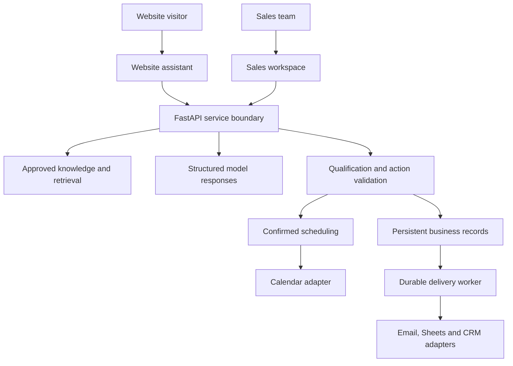
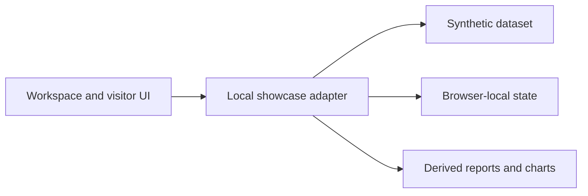

# AI Sales Agent | Systematic Sales Workspace

**A client project connecting inbound conversations, lead qualification and sales follow-through.**

> **Client confidentiality:** This project was developed for a client. In accordance with the client's disclosure restrictions, only the frontend is published here. The backend, proprietary business knowledge, prompts, customer data, credentials and private infrastructure remain excluded. This README explains the complete project's purpose and architecture; the public application demonstrates its experience using fictional data and simulated actions.

**React 19 · TypeScript · Vite · Sales operations · Conversational AI**

## Project overview

AI Sales Agent brings a website assistant and a sales operations workspace into one connected journey. The wider full-stack project helps service businesses understand incoming inquiries, capture useful context, qualify interest and move each conversation toward a clear next step: a consultation, a proposal request or a human handover.

The operator workspace makes that journey visible. Teams can review leads, continue conversations, assign follow-up work, inspect upcoming meetings and compare acquisition sources without reconstructing the customer's story across disconnected tools.

This repository provides an interactive portfolio edition of that experience. It runs independently in the browser with a populated 90-day dataset and editable workflows, so visitors can explore the product without access to the client's systems.

## The business problem

For agencies, consultancies and other service businesses, the challenge is often what happens **after an inquiry arrives**:

- Visitors ask questions before they are ready to complete a structured brief.
- Sales teams receive incomplete contact information and repeat discovery questions.
- Conversation history, bookings and follow-up notes become scattered across tools.
- Proposal and handover requests lack a clear owner or next action.
- Activity totals alone do not explain which channels produce qualified opportunities.

The project addresses these gaps through a shared workflow: **engage → understand → qualify → act → follow through → measure**. Its intended value is clearer ownership, preserved customer context and more consistent sales execution. No revenue uplift, conversion improvement or client performance figure is claimed.

## The complete customer journey

1. **Engage:** A website visitor starts a conversation about the business's services.
2. **Understand:** The private system uses approved business information and structured model responses to answer relevant questions and gather context.
3. **Qualify:** Contact details, service interest and qualification signals become a reviewable lead record.
4. **Choose a next step:** The visitor requests a consultation, asks for a proposal or seeks help from a person.
5. **Follow through:** Operators manage ownership, due dates, notes and outcomes. Private integration adapters support scheduling and business-system delivery when configured.
6. **Measure:** Session cohorts and source reporting help the team examine how interest progresses through the sales workflow.

The product serves inbound inquiries. It does not discover prospect lists or run unsolicited outreach campaigns. A proposal request creates a sales task; it does not generate a finished proposal document.

## Explore the workspace

| Area | Purpose | Public demo interactions |
| --- | --- | --- |
| **Overview** | Understand current activity and priorities | Reporting periods, conversation charts, priority leads and meeting summaries |
| **Lead pipeline** | Organize and qualify opportunities | Search, stage and priority filters, pagination, profile edits, notes and CSV export |
| **Conversations** | Preserve context and support human assistance | Message history, simulated takeover and local team replies |
| **Meetings** | Review committed customer steps | Sample consultations and a visitor booking rehearsal |
| **Sales desk** | Make follow-through accountable | Request assignment, due dates, progress notes, outcomes and history |
| **Sales insights** | Compare activity and acquisition quality | 7/14/30/90-day cohorts, source comparisons and outcome charts |
| **Automations** | Surface delivery work needing attention | Fictional queued jobs, retry and simulated processing |
| **Knowledge base** | Organize information supporting the assistant | Search, add and remove sample documents |
| **Settings** | Adapt the workspace to a business | Local identity, service and qualification preferences |

The visitor experience includes a sample business website and an assistant with explicitly labelled scripted replies, demonstrating the connection between customer actions and operator workflows.

### Demo data and behavior

- **90 days of fictional activity**, with more than **800 sessions** and **500 lead profiles**.
- Varied sources, stages, conversations, meetings and follow-up requests.
- Charts and reports calculated from linked records, keeping the demonstration internally consistent.
- Browser-local edits, with **Reset demo** available to restore the seed dataset.
- No backend, paid API, model key or external account needed.

Names, companies, messages and scenarios in the seed data are fictional. Seed email addresses use `example.com`. Use fictional details when exploring forms. Each browser has its own data; changes are not shared with other visitors. If local storage is unavailable, the app falls back to in-memory state and changes may be lost on reload.

## Architecture and implementation

The wider client application separates the user experience, conversational reasoning, validated actions and delivery work:



The diagram describes the private project's architecture. These backend services are not included or connected in this repository.

| Layer | Technology and responsibility | Published here |
| --- | --- | --- |
| User experience | React 19, TypeScript, Vite, Radix Dialog, Lucide icons and responsive CSS | Yes |
| Demo behavior | Local TypeScript adapter, synthetic records and browser persistence | Yes |
| API and domain | Python, FastAPI and Pydantic for request and action validation | No |
| Conversational reasoning | Gemini structured responses and approved knowledge retrieval | No |
| Persistence | SQLAlchemy with SQLite for local operation and PostgreSQL support | No |
| Scheduling and delivery | Calendar, Sheets, SMTP and CRM adapters with a separate Python worker | No |

For this public edition, the frontend selects a local showcase adapter at build time:



### Engineering priorities

- **Coherent records:** conversations, leads, requests and reporting describe connected customer journeys.
- **Reliable analytics interactions:** reports retain accurate period labels during updates, with protection against stale responses.
- **Clear ownership:** sales tasks record responsibility, progress and outcomes instead of stopping at contact capture.
- **Usable large lists:** lead pagination and progressive conversation loading keep the populated demo manageable.
- **Accessible controls:** labelled dialogs, keyboard chart inspection, navigation focus handling and reduced-motion support.
- **Static deployment:** query-based visitor views and hash-based workspace navigation support hosting without a backend router.

## Run locally

Use **Node.js 22.12 or newer** and npm.

```bash
git clone https://github.com/numan-developer-2/AISalesAgent.git
cd AISalesAgent
npm ci
npm run dev
```

Open **http://localhost:5173**. Enter workspace ID **`systematic`** and choose **Open demo workspace**. No email or password is required. This entry screen is a demonstration gate, not production authentication.

On Windows PowerShell, use `npm.cmd` if your execution policy blocks `npm.ps1`.

```bash
# Run the frontend tests
npm test

# Compile TypeScript and build the standalone showcase
npm run build

# Preview the production build at http://localhost:4173
npm run preview
```

The production output is **`dist-showcase/`**. Default development and build commands select showcase mode automatically.

## Deploy on Vercel

Import this GitHub repository into Vercel and use these settings:

| Setting | Value |
| --- | --- |
| Framework preset | Vite |
| Root directory | Repository root (`./`) |
| Install command | `npm ci` |
| Build command | `npm run build` |
| Output directory | `dist-showcase` |
| Node.js | 22.x or a supported newer version meeting the package requirement |
| Environment variables | None required |

The included `vercel.json` defines the install command, build command and output directory. Workspace navigation uses URL hashes and visitor views use query parameters, so the demo does not require backend endpoints or path rewrites. See [Vercel's Vite deployment documentation](https://vercel.com/docs/frameworks/frontend/vite) for platform setup.

## Suggested walkthrough

1. Open Overview and compare short-term and 90-day activity.
2. Filter the lead pipeline and update a fictional lead's next action.
3. In Sales insights, select an outcome metric and switch reporting periods.
4. Open **Preview assistant**, request a proposal and submit fictional details.
5. Return to the workspace, refresh and review the request in Sales desk.
6. Assign an owner, record progress and try a simulated consultation booking.
7. Use **Reset demo** to restore the initial dataset.

## Verification and boundaries

The frontend includes **36 automated tests** covering workspace navigation, analytics interactions, delayed and out-of-order responses, keyboard chart controls, local edits, request ownership, visitor flows and reporting consistency. The suite and production build passed during preparation. Tests include checks that showcase actions do not make unexpected network calls.

Automated validation does not replace visual review across browsers and devices. A deployed Vercel instance must still be checked after deployment; no live production certification is implied.

**Public demo limitations:** chat responses are scripted and do not call an LLM. Sample knowledge edits do not train or ground a model. Bookings, replies and automation actions update local demo state; they do not send emails, create external calendar events or update a CRM. Reports count sessions rather than unique people, and overlapping outcomes are not a sequential attribution funnel.

**Private system context:** live model quality, provider connectivity, credentials, infrastructure and operational acceptance remain deployment responsibilities outside this public repository.

## Repository scope

```text
src/                 Frontend components, styles, types, demo adapter and tests
index.html           Application entry point
package.json         Dependencies and development commands
package-lock.json    Reproducible dependency resolution
tsconfig.json        TypeScript configuration
vite.config.ts       Frontend build and test configuration
vercel.json          Static deployment settings
.gitignore           Local files excluded from version control
README.md            Product case study and usage guide
```

Only the frontend and this README are shared, along with configuration needed to install, test, build and host the application. Backend source, real customer records, client documents, environment files and operational secrets are not part of the public distribution.

**Developed by [Numan](https://github.com/numan-developer-2).**
