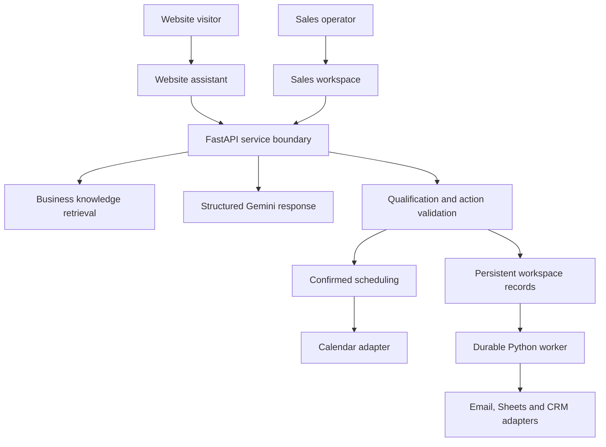
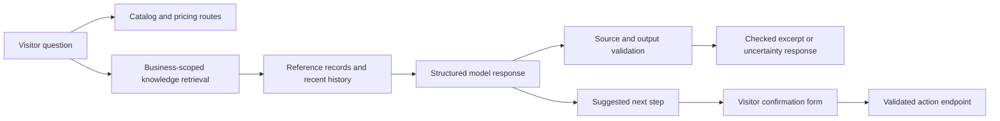

# AI Sales Agent | Systematic Sales Workspace

**From an inbound question to an accountable sales workflow.**

> **Client-project disclosure:** This project originated from client work. This public edition includes the frontend, backend, knowledge-preparation tools and automated tests with fictional business configuration and sample knowledge. Client environment files, API keys, OAuth credentials, customer records, original company documents and private operational artifacts are excluded. The bundled business is a demonstration, not the client's production deployment.

**React 19 · TypeScript · FastAPI · Python · SQLAlchemy · Gemini integration · RAG · Sales automation**

## Why this project exists

An interested website visitor rarely arrives with a complete brief. Questions appear in chat, contact details arrive through forms, meeting requests move into calendars, and follow-up ownership can disappear between tools. Sales teams need a reliable way to understand both **who is interested** and **what should happen next**.

AI Sales Agent connects a website assistant with an operator workspace. It supports service discovery, qualification, conversation history, consultation requests, human handover, sales-task ownership and source reporting. The intended value is clearer context and more consistent execution for agencies, consultancies and other service businesses handling inbound inquiries. No client revenue, conversion uplift or production SLA is claimed.

## The customer journey

1. **Engage:** A visitor asks about the business's services.
2. **Understand:** Approved knowledge and structured business facts support the response.
3. **Qualify:** Explicit contact details and requirements become a lead profile with explainable scoring.
4. **Act:** The visitor confirms a consultation, proposal request or human handover through a validated form.
5. **Follow through:** Operators assign owners, update due dates, continue conversations and record outcomes.
6. **Measure:** Session cohorts and source reporting show how inquiries progress.

This is an inbound sales system. It does not discover prospect lists or send unsolicited cold outreach. A proposal request creates a sales task, not an automatically generated proposal document.

## Product capabilities

| Workspace | Business purpose | Implementation |
| --- | --- | --- |
| Overview | Understand current activity and priorities | Period filters, conversation charts, priority leads and meetings |
| Lead pipeline | Organize and qualify opportunities | Search, filters, notes, stages, ownership, next actions and CSV export |
| Conversations | Preserve context and support personal assistance | Saved messages, human takeover, operator replies and AI pause |
| Meetings | Turn interest into an agreed next step | Availability, expiring offers, confirmation and duplicate protection |
| Sales desk | Make follow-through accountable | Proposal/handover assignment, due dates, notes, outcomes and history |
| Sales insights | Compare acquisition and outcomes | 7/14/30/90-day cohorts, source comparisons and outcome charts |
| Automations | Manage delivery work | Durable jobs, leases, retries, blocked states and operator retry |
| Knowledge base | Maintain business information | Approved knowledge search, manual additions and deletion |
| Settings | Adapt the experience to a business | Identity, services, qualification, working hours and integration preferences |

## Choose an operating mode

| Mode | What runs | Storage and external actions |
| --- | --- | --- |
| **Frontend showcase** | Static browser application with 90 days of fictional activity, 800+ sessions and 500+ leads | Browser-local state; scripted replies and simulated actions; no backend required |
| **Backend-connected demo** | React + FastAPI + database + worker using `APP_MODE=demo` | Real local persistence and API workflows; deterministic replies and simulated delivery; smaller starter dataset |
| **Configured live system** | Backend-connected UI with `APP_MODE=live` and selected provider integrations | Requires your own approved knowledge, credentials, HTTPS and acceptance testing |

The showcase and backend database are independent. Resetting the browser demo does not reset the server database. Names, contacts and commercial scenarios bundled with this public edition are fictional; use sample details during evaluation.

## Architecture



The API owns validation and state transitions. The model proposes intent and supported facts; it cannot directly send messages or book meetings. A separate worker performs configured delivery tasks. n8n is not required by the runtime.

| Layer | Technologies |
| --- | --- |
| Frontend | React 19, TypeScript, Vite, Radix Dialog, Lucide icons, responsive CSS |
| API and domain | Python, FastAPI, Pydantic |
| Persistence | SQLAlchemy; SQLite locally, PostgreSQL support |
| AI and retrieval | Gemini structured responses; local lexical retrieval; optional Supabase pgvector |
| Delivery | Google Calendar, Google Sheets, SMTP and authenticated HTTPS CRM adapters |
| Quality | pytest, Vitest, Testing Library, HTTP smoke workflows and TypeScript compilation |

## How company knowledge powers the assistant

The RAG layer connects a visitor's question to approved company information before the assistant produces a factual response. RAG means **retrieval-augmented generation**: retrieving reference material at request time, rather than assuming the model already knows the company's services, policies or prices. It does not train a new model on each uploaded document.

### 1. Prepare approved knowledge

The preparation pipeline organizes website and business content into identifiable chunks. Each chunk carries source text, a stable identifier, a title, a source URL and content metadata. Pricing is also stored as structured records so amounts, currency, billing periods, service mappings and review status can be checked explicitly.

On first workspace initialization, the backend imports the configured business's frozen JSONL corpus into its own persisted knowledge records. Existing business records remain authoritative on restart. Operators can add or remove approved knowledge through the workspace. Changing a source file does not automatically refresh an already initialized knowledge base; content updates need a deliberate review and import process.

### 2. Retrieve relevant company context

| Retrieval path | Actual implementation | Scope |
| --- | --- | --- |
| Default workspace retrieval | Keyword overlap over persisted knowledge, with extra weight for title matches | Restricted to the current business's records |
| Optional vector retrieval | Query embeddings and a Supabase pgvector similarity RPC, with ranked source chunks | Optional legacy integration for the configured Systematic business |

The default path is lexical retrieval, not semantic vector search. The optional vector path requires a compatible, separately ingested corpus and configured provider access. It is not automatically provisioned for each new business. The embedding pipeline validates vector dimensions and rejects non-finite values; the reusable context builder limits assembled reference length, including source separators.

### 3. Apply business rules before generation

Service catalog questions and reviewed pricing can be answered through deterministic routes. A service-specific price must map to the requested service; an unrelated published package is not treated as its quote. Unreviewed or unsupported pricing falls back to team confirmation.

For other live questions, the workspace supplies business context, recent conversation history and retrieved records to Gemini with a structured response schema. Reference material and visitor messages are treated as data, while system instructions define the assistant's role. A pattern filter excludes some suspicious reference content; this is a defensive check, not a guarantee against every prompt-injection technique.

### 4. Validate evidence and communicate uncertainty

The model returns structured intent, proposed lead updates, action suggestions and source evidence. The workspace verifies that cited source IDs exist and quoted text occurs in the supplied records. It rejects unsupported numerical/contact claims and claims that an external action has already completed. Published factual responses use checked source excerpts instead of unchecked generated factual prose.

If evidence is insufficient, the assistant says it cannot confirm the answer and offers human assistance. Source matching establishes where text came from; it does not certify that a company's source material is correct, current or sufficient for the question. Business review and representative answer-quality evaluation remain essential.

### 5. Keep conversation and execution separate

An AI suggestion to book a meeting or request a proposal cannot execute that action on its own. Separate API endpoints validate contact details, explicit confirmation and business ownership. Booking offers expire, repeated requests are handled idempotently, and uncertain external booking outcomes can require operator reconciliation.



The standalone showcase simulates this experience. The backend-connected mode runs the actual API, persistence and validation code. Live inference needs your own provider credentials and reviewed knowledge; no client corpus or account is included.

## Reliability and engineering decisions

- **Business isolation:** operational records and sessions are scoped to a business; visitor tokens identify one conversation.
- **Conservative factual output:** reviewed catalog/pricing routes and checked source excerpts limit unsupported claims.
- **Explicit execution:** expiring booking offers, confirmation, idempotency and uncertain-booking reconciliation separate intent from completed actions.
- **Recoverable delivery:** persisted jobs use deduplication, leases and retries, with blocked states for missing configuration.
- **Consent-aware follow-up:** suppression, consent and lead status are checked before follow-up delivery.
- **Stable UI interactions:** analytics protect against stale responses; large lists use pagination or progressive loading; dialogs and charts expose keyboard controls.
- **Bounded inputs:** API write bodies are limited to 64 KiB before parsing; model and embedding requests use transport limits.

External delivery is at least once, not exactly once. An interrupted SMTP request can still have an uncertain outcome. The rate limiter is process-local; begin with one API process and one worker. Shared limiting, schema migrations, capacity planning and backup recovery need deployment-specific validation.

## Quick start: frontend showcase

Requirements: Node.js 22.12 or newer and npm.

```bash
git clone https://github.com/numan-developer-2/AISalesAgent.git
cd AISalesAgent
npm ci
npm run dev
```

Open **http://localhost:5173**, enter workspace ID **`systematic`**, and select **Open demo workspace**. No password is needed for demo mode. On Windows, use `npm.cmd` if PowerShell blocks `npm.ps1`.

```bash
npm test
npm run build
npm run preview
```

The default build creates `dist-showcase/`; preview uses port 4173. No API keys or environment variables are needed for this mode. Browser storage is local to each visitor, with an in-memory fallback if storage is unavailable.

## Run the backend-connected application

The Python dependency lock was validated with **Python 3.13 on Windows**. Commands below use PowerShell from the cloned repository root.

```powershell
python -m venv .venv
.\.venv\Scripts\python.exe -m pip install -r backend/requirements-dev.txt
$env:PYTHONPATH = 'backend/src'
$env:APP_MODE = 'demo'
$env:APP_ORIGIN = 'http://localhost:5173'
.\.venv\Scripts\python.exe -m uvicorn workspace.api:app --host 127.0.0.1 --port 8000
```

In a second terminal, from the same repository:

```powershell
npm.cmd run dev:connected
```

In a third terminal, run the worker:

```powershell
$env:PYTHONPATH = 'backend/src'
$env:APP_MODE = 'demo'
.\.venv\Scripts\python.exe -m workspace.worker
```

Open **http://localhost:5173** and use workspace ID **`systematic`**. API docs are at **http://localhost:8000/api/docs** in demo mode. Demo and live modes use separate ignored databases under `data/runtime/` unless `APP_DATABASE_URL` overrides the connection.

To serve the connected frontend directly from FastAPI, run `npm run build:connected` and restart the API. Open **http://localhost:8000**. The backend serves `dist/`; it does not serve the browser-only showcase bundle.

On macOS/Linux, use `.venv/bin/python` and `export PYTHONPATH=backend/src` / `export APP_MODE=demo` in place of PowerShell syntax. Linux/container acceptance is still pending for the current lock.

### Backend checks

```powershell
$env:PYTHONPATH = 'backend/src'
.\.venv\Scripts\python.exe -m pytest backend/tests -q
npm.cmd run build:connected
.\.venv\Scripts\python.exe scripts/qa/run_workspace_http_smoke.py
```

The HTTP runner starts an isolated demo API and worker, verifies capture, assignment, simulated booking, job processing and restart persistence, then stops its processes. Reports and temporary databases are gitignored.

## Knowledge preparation and optional vector ingestion

`scraper/` contains discovery, extraction, cleaning, classification, deduplication and chunking code. Its public configuration points to `example.com`; replace it with an approved site before an intentional crawl. Generated website content and review artifacts are excluded from Git.

```bash
cd scraper
python -m pip install -r requirements.txt
python -m pytest tests -q
python -m src.main --mode full
```

Use a separate Python environment for optional scraper dependencies. Review extracted facts before importing them. The bundled `data/knowledge/` corpus contains five newly authored fictional examples, plus synthetic service/profile/pricing records. Its sample price is marked **needs review**, so it is not offered as an approved quote.

Validate the bundled vector-ingestion inputs without credentials or network writes:

```bash
python scripts/ingestion/ingest_knowledge.py --dry-run
```

For optional Supabase retrieval, provision the knowledge schema from `supabase/migrations/001_rag_knowledge_schema.sql`, configure matching embedding settings and server-side credentials, and explicitly run the ingestion script against your intended database. Ingestion performs paid embedding calls and database upserts when `--dry-run` is omitted. Never put a Supabase server key in the frontend.

Migrations `002` and `003` support the earlier standalone sales-agent/action modules. The workspace API instead creates its own `workspace_*` tables, using a private schema on PostgreSQL. These are distinct persistence paths, not automatic migrations of one into the other.

## Configuration and live services

No `.env` or credential file is distributed. Provide values through your shell, deployment secret store or a local ignored `.env`. Demo mode needs no external credentials.

| Configuration | Purpose |
| --- | --- |
| `APP_MODE`, `APP_ORIGIN`, `COOKIE_SECURE` | Runtime mode and trusted frontend origin; live mode requires HTTPS and secure cookies |
| `APP_DATABASE_URL` | Optional PostgreSQL connection using the `postgresql+psycopg://` dialect |
| `ADMIN_EMAIL`, `ADMIN_PASSWORD_HASH` | Live operator authentication |
| `GEMINI_API_KEY`, `GEMINI_CHAT_MODEL` | Live structured model responses |
| `RAG_PROVIDER` | `local` by default; optional `supabase` path for the default business |
| `SUPABASE_URL`, `SUPABASE_SECRET_KEY` | Server-side access to the optional vector corpus |
| `GEMINI_EMBEDDING_MODEL`, `GEMINI_EMBEDDING_DIMENSION` | Matching ingestion/query configuration; current implementation expects `gemini-embedding-2` and 768 dimensions |
| `GOOGLE_CALENDAR_ID`, `GOOGLE_CALENDAR_TOKEN_FILE` | Calendar scheduling authorization |
| `SMTP_HOST`, `SMTP_PORT`, `SMTP_USER`, `SMTP_PASSWORD`, `SMTP_FROM` | Email notifications and consented follow-up |
| `GOOGLE_SHEET_ID`, `GOOGLE_SHEETS_TOKEN_FILE` | Sheets delivery |
| `CRM_WEBHOOK_URL`, `CRM_API_KEY` | Authenticated HTTPS CRM webhook |

Enable only the intended adapters in business settings and configure their destinations. Credential presence does not prove a connection works. New businesses use independent prefixes such as `ACME_GEMINI_API_KEY`; they do not inherit the default business's credentials.

```bash
# Interactive password hashing; password input is hidden
python scripts/setup_workspace.py --password-hash

# Create a separate business configuration
python scripts/setup_workspace.py --id acme --name "Acme Demo" --website https://acme.example

# OAuth setup requires your own private client file
python scripts/google/authorize_workspace.py calendar --client config/google_calendar_credentials.json --token config/google_calendar_token.json
```

Optional acceptance tools:

```bash
# Makes up to three live model calls and stops on provider errors
python scripts/qa/run_workspace_answer_qa.py --live

# Checks presence and Calendar free/busy; creates no event or credential file
python scripts/qa/run_workspace_service_check.py --calendar-readonly
```

## Deployment

**Vercel hosts the frontend showcase.** Import this repository with Vite, root directory `./`, install command `npm ci`, build command `npm run build`, and output directory `dist-showcase`. No environment variables are needed. `vercel.json` already supplies these settings. See [Vercel's Vite documentation](https://vercel.com/docs/frameworks/frontend/vite).

**The connected application needs a Python host, persistent database and worker.** The included Dockerfile builds the connected frontend, and `docker compose up --build` provides a local demo API/worker configuration with a named data volume. It intentionally binds to loopback and runs demo mode; it is not a production hosting configuration. Container execution, PostgreSQL and HTTPS acceptance remain unverified in this environment.

## Quality and readiness

The November 18 public-package verification passed **198 backend tests**, **36 frontend tests** and **12 scraper tests**. Both frontend build modes and the running API/worker demo workflow passed. The fictional ingestion inputs passed a dry run without credentials or network writes. Dependency updates addressed advisories in certifi, OAuthlib, OpenTelemetry API and pyasn1; the fresh audit of 78 locked backend runtime packages reported zero known vulnerabilities. Audit results are point-in-time evidence, not a guarantee of security.

The reviewed live setup is **not production-approved**: a Gemini probe returned a transient provider error, Calendar token refresh failed, and selected delivery/admin settings were missing. This public repository includes none of those accounts or credentials. Complete your own provider, business-knowledge, deployment and browser acceptance before enabling real actions.

The current Starlette TestClient emits one deprecation warning about its HTTPX transport; the scraper run also emitted BeautifulSoup/lxml deprecation warnings. Visual browser/device QA, load testing and backup restore remain separate checks. Reports count sessions rather than unique people; outcome categories may overlap and do not establish advertising ROI.

## Repository layout

```text
src/                    React workspace, assistant, showcase adapter and frontend tests
public/                 Embeddable assistant launcher
backend/src/            Workspace API, RAG, agents, domain services and worker
backend/tests/          Backend regression tests
config/businesses/      Fictional business configuration
data/knowledge/         Fictional sample corpus and structured knowledge
data/examples/          Small synthetic evaluation inputs
scraper/                Knowledge-preparation source, configuration and tests
scripts/                Setup, OAuth, ingestion and QA utilities
supabase/migrations/    Optional vector and earlier sales-module schemas
Dockerfile              Connected application image definition
compose.yaml            Local API/worker demo configuration
vercel.json             Standalone showcase deployment settings
README.md               Product, architecture and setup guide
```

The repository excludes client documents, real records, runtime databases, scraped outputs, credentials, internal presentations, historical QA reports, temporary folders and dependency/build artifacts.

**Developed by [Numan](https://github.com/numan-developer-2).**
